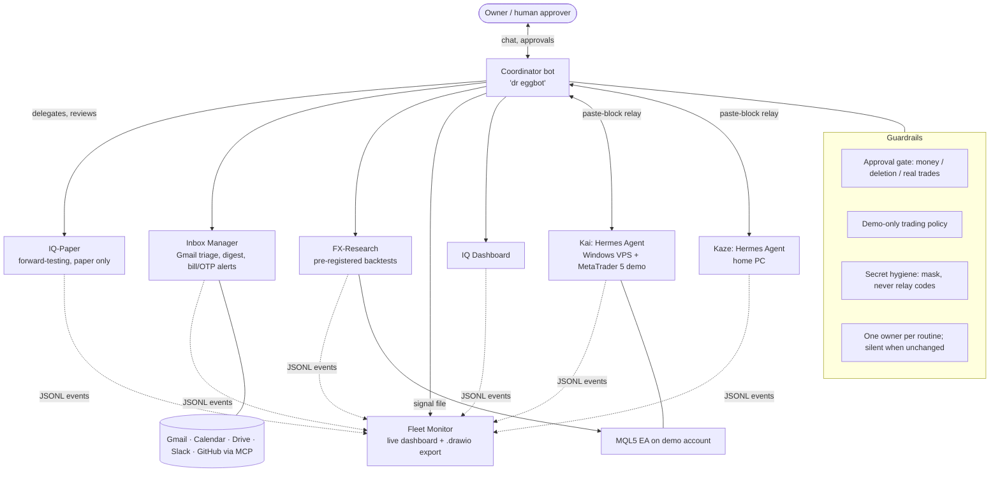

# AI Agent Ops Portfolio

Real-world evidence of designing, operating, and hardening a **multi-agent AI system** for a small business owner in Thailand. Built and run Sep–Oct 2026 by Preeda Wisetsunthonr ("Som Noi").

> This repository documents **engineering and operations practice**: agent orchestration, guardrails, reliability, and research method.
> It makes **no trading-performance claims**. All trading-related work is research or demo-only.
> Secrets, account identifiers, hostnames, and private endpoints have been removed.

## What's inside
| Path | What it shows |
|---|---|
| [case-studies/01-multi-agent-fleet.md](case-studies/01-multi-agent-fleet.md) | Coordinator + specialist bots, hierarchical reporting, approval gates |
| [case-studies/02-agent-onboarding-and-skills.md](case-studies/02-agent-onboarding-and-skills.md) | Training a new agent like an employee: work rules plus an 8-skill pack |
| [case-studies/03-self-healing-watchdog.md](case-studies/03-self-healing-watchdog.md) | Boot autostart, 5-min watchdog, kill-tests, root-cause fixes |
| [case-studies/04-rigorous-backtest-methodology.md](case-studies/04-rigorous-backtest-methodology.md) | About 645 pre-registered trials, Bonferroni, untouched holdout, honest negative result |
| [case-studies/05-agent-driven-pc-maintenance.md](case-studies/05-agent-driven-pc-maintenance.md) | Safe, reversible disk cleanup by an agent (7.2 GB to about 26–30 GB free) |
| [examples/SKILL_TEMPLATE.md](examples/SKILL_TEMPLATE.md) | Reusable skill file template |
| [examples/WORK_RULES_TEMPLATE.md](examples/WORK_RULES_TEMPLATE.md) | Agent operating rules template (loop, hard rules, routing, report format) |
| [examples/watchdog.ps1](examples/watchdog.ps1) | Sanitized Windows watchdog for a self-hosted agent |
| [examples/register-tasks.ps1](examples/register-tasks.ps1) | Registers the boot-autostart and 5-min watchdog scheduled tasks |
| [examples/fleet-event-schema.md](examples/fleet-event-schema.md) | JSONL event schema used by the live fleet dashboard |
| [examples/shared-skills/](examples/shared-skills/) | Fleet-wide skills: routine gate, ETA/late-ping, secret hygiene, data-source label |
| [examples/shared-skills/bot-install-checklist/](examples/shared-skills/bot-install-checklist/SKILL.md) | Check disk and web-vs-trade-port network limits before installing software on a shared bot machine |
| [examples/shared-skills/session-resume/](examples/shared-skills/session-resume/SKILL.md) | After a chat reset, auto-read the handoff note and continue pending work without re-briefing |
| [examples/shared-skills/handoff/](examples/shared-skills/handoff/SKILL.md) | Compress a conversation into a durable 6-section handoff file before clearing chat |
| [examples/shared-skills/hermes-self-maintain-pack/](examples/shared-skills/hermes-self-maintain-pack/SKILL.md) | Checklist to keep a Hermes gateway alive on Windows: boot task, watchdog, kill-test, safe upgrades |

## Resume & profile
| Path | What it is |
|---|---|
| [resume/RESUME_EN.md](resume/RESUME_EN.md) | Resume (English) |
| [resume/RESUME_TH.md](resume/RESUME_TH.md) | Resume (Thai / ภาษาไทย) |
| [resume/LINKEDIN_EXPERIENCE_DRAFT.md](resume/LINKEDIN_EXPERIENCE_DRAFT.md) | LinkedIn experience, education, languages, and skills text |

More reusable agent skills: [SomNoi/agent-skills](https://github.com/SomNoi/agent-skills).

## Architecture

**Design principles**
1. **Hierarchy.** Specialists report only to the coordinator, and only the coordinator talks to the human. This keeps notifications low and accountability clear.
2. **Approval gates.** Anything irreversible or financial needs explicit approval for that exact action.
3. **Read-only first.** Agents inspect, then propose, then act, then verify.
4. **Recover, don't loop.** Failures are contained and reported. Retries are bounded.
5. **Honest reporting.** Results are marked `verified` or `unverified`, and negative results are published as-is.

## Tech
Hermes Agent (Nous Research, open source) · MCP connectors (Gmail, Calendar, Drive, Slack, GitHub, draw.io) · Python · PowerShell · Windows Task Scheduler · cron · MetaTrader 5 / MQL5 · Markdown skills (SKILL.md)

## License
MIT. See [LICENSE](LICENSE).
